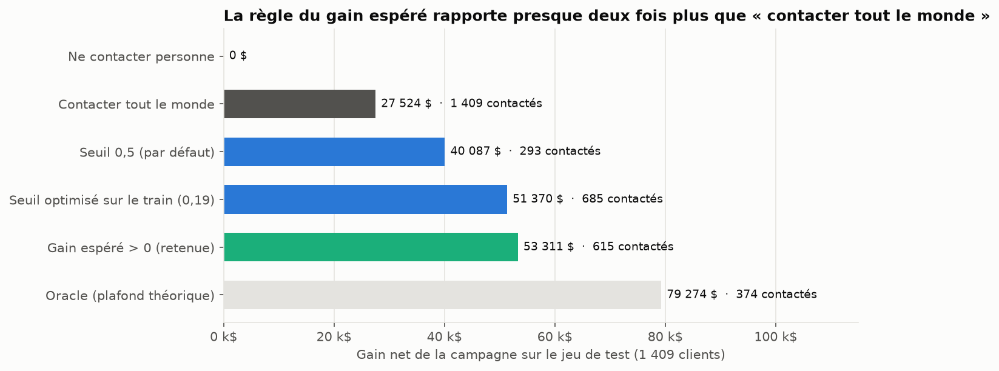
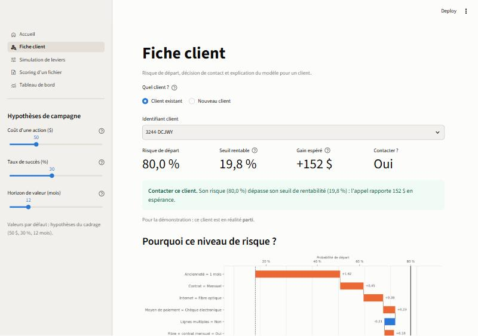
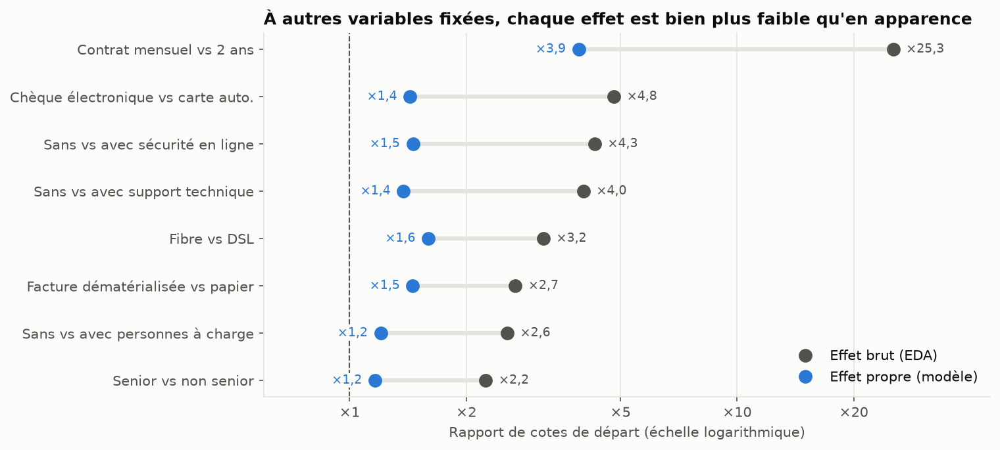
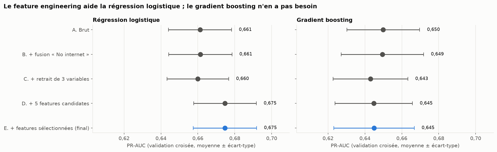
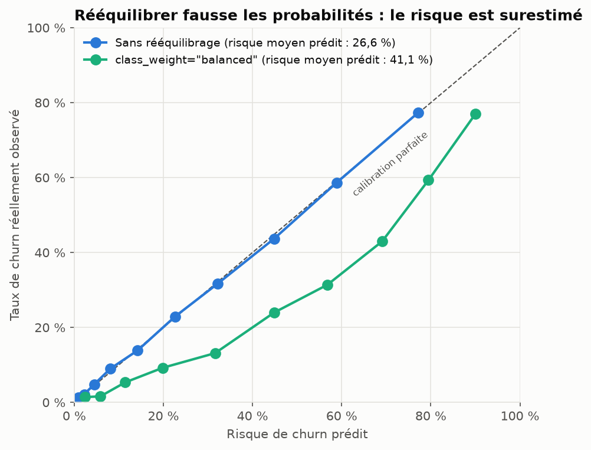
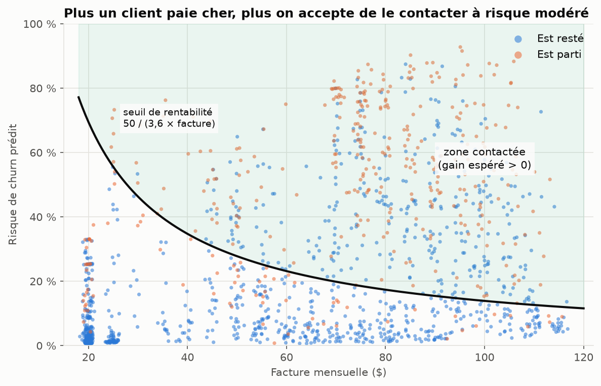
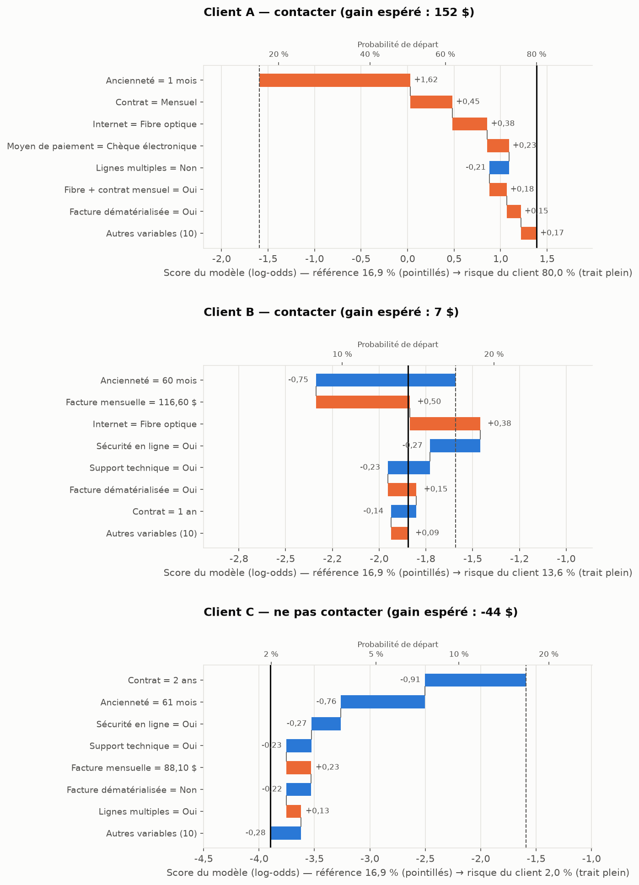
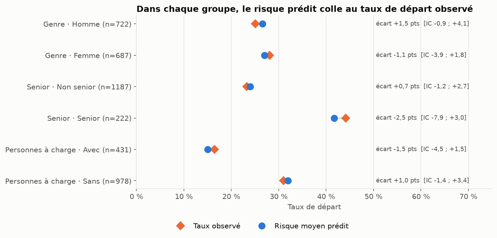

# Prédiction du churn client : décider qui contacter, et pour quel gain

> Identifier les clients d'un opérateur télécom sur le point de partir, comprendre pourquoi, et décider lesquels cibler pour **maximiser le gain net** d'une campagne de rétention. Le projet va du cadrage métier jusqu'à une application déployée.

[](https://projetchurnclients-bcn6dfiavqhmbjycj87huf.streamlit.app/)

**▶ Essayer l'application : [projetchurnclients.streamlit.app](https://projetchurnclients-bcn6dfiavqhmbjycj87huf.streamlit.app/)**

## En 30 secondes

**Le problème.** Sur 7 043 clients, **26,5 % sont partis**, soit **~1,67 M$** de revenu annuel perdu. Prédire le churn ne suffit pas : il faut savoir **qui appeler** pour que la campagne soit rentable.

**La solution.**
1. Un modèle **calibré**, qui donne de vraies probabilités de départ.
2. Une règle de décision **dérivée des coûts** : contacter un client si `risque × taux de succès × valeur du client > coût de l'action`.
3. Une **explication** de chaque prédiction en langage métier.

**Les résultats**, mesurés sur 1 409 clients que le modèle n'a jamais vus :

| | |
|---|---|
| 💰 **Gain net de la campagne** | **53 311 $**, soit ~37 800 $ pour 1 000 clients et **67 %** du gain d'un oracle |
| 📈 **Face aux alternatives** | **×1,9** par rapport à « contacter tout le monde », **+33 %** par rapport au seuil de 0,5 par défaut |
| 🎯 **Qualité du classement** | PR-AUC **0,665** (hasard : 0,265), ROC-AUC 0,848 |
| ⚖️ **Équité** | Probabilités aussi fiables pour tous les groupes (genre, âge, famille) |
| 🧪 **Code** | 76 tests automatisés, application testée page par page |

**Stack :** Python · pandas · scikit-learn · Optuna · XGBoost / LightGBM (comparaison) · SHAP · Streamlit · pytest



## L'application

Elle est pensée pour l'équipe de rétention. Les hypothèses économiques (coût d'une action, taux de succès, horizon) sont réglables et s'appliquent partout.

| Page | Usage |
|---|---|
| **Fiche client** | Risque de départ, seuil de rentabilité, décision (contacter ou non) et **pourquoi** (explication SHAP) |
| **Simulation de leviers** | Effet d'une offre (contrat annuel, support technique, paiement automatique…) sur le risque, et **coût maximal** de l'offre pour qu'elle reste rentable |
| **Scoring d'un fichier** | Import d'un CSV, **liste d'appels** priorisée par gain espéré, mode budget limité, export Excel |
| **Tableau de bord** | Gain réellement obtenu selon la stratégie, recalculé en direct selon les hypothèses |



## Ce qui fait la rigueur du projet

- **Jeu de test sous clé** dès le premier jour : toutes les décisions (features, modèle, seuil) sont prises en validation croisée sur l'entraînement. Le test n'est ouvert qu'une fois, pour mesurer.
- **Comparaison honnête des modèles.** 5 familles sont évaluées sur les mêmes 15 plis, avec un **t-test corrigé de Nadeau & Bengio**. XGBoost et LightGBM optimisés ne battent pas significativement la régression logistique : on retient la plus simple, la mieux calibrée et la plus explicable.
- **Pas de rééquilibrage des classes.** SMOTE et `class_weight` n'amélioraient pas le classement et **faussaient les probabilités** (41 % de risque prédit pour 26,5 % réel). Le déséquilibre est traité là où il doit l'être : par la règle de décision.
- **Décision dérivée des coûts, pas d'un seuil arbitraire.** Le seuil s'adapte à chaque client : de 12 % de risque pour un client à 117 $/mois à 76 % pour un client à 18 $/mois. La règle ne perd d'argent dans **aucun** des 20 scénarios économiques testés.
- **Explications exactes et honnêtes.** SHAP exact pour un modèle linéaire. Il distingue l'**effet propre** de l'effet brut : le contrat mensuel passe de ×25 à ×4 sur la cote de départ. La colinéarité est détectée (facture ≈ somme des services, R² = 0,999), et les leviers actionnables sont séparés des simples corrélats.
- **Audit d'équité** : calibration par groupe avec intervalles bootstrap. On montre aussi que l'âge peut être retiré du modèle **sans perte** (p = 0,78).
- **Code industrialisé** : package `src/churn` (nettoyage, pipeline, règle business, explications, service), réutilisé tel quel par l'application. Versions figées pour le déploiement, 76 tests.

## Insights métier

Issus de l'analyse exploratoire, puis **vérifiés à autres variables fixées** par le modèle.

| Insight | Chiffre clé | Levier |
|---|---|---|
| Le **contrat mensuel** est le 1er facteur, même à ancienneté égale | 42,7 % de départs contre 2,8 % en contrat 2 ans | Offre de passage en contrat annuel |
| Les **6 premiers mois** sont critiques | 52,9 % de départs ; cote divisée par 12 entre 1 et 72 mois | Programme d'onboarding |
| **Fibre + contrat mensuel** : segment prioritaire | 30 % des clients, **72 % du revenu perdu** | Y concentrer le budget |
| Les **services de protection** fidélisent | De 56,7 % (aucun) à 5,3 % (quatre) | Offrir sécurité en ligne ou support (à tester en A/B) |
| Le sur-risque des **seniors** est surtout un effet de composition | ×2,2 en brut, ×1,2 à autres variables fixées | Ne pas cibler l'âge en tant que tel |



## Démarche et notebooks

| Phase | Contenu | Notebook |
|---|---|---|
| 0 | Cadrage métier : problématique, matrice de gain, critères de succès | [cadrage](docs/cadrage_metier.md) |
| 1 | Mise en place : dépôt, environnement, package, tests | — |
| 2 | Qualité des données : valeurs manquantes cachées, cohérence | [02](notebooks/02_qualite_donnees.ipynb) |
| 3 | Analyse exploratoire orientée insights, tests statistiques | [03](notebooks/03_analyse_exploratoire.ipynb) |
| 4 | Feature engineering, pipeline sans fuite, étude d'ablation | [04](notebooks/04_feature_engineering.ipynb) |
| 5 | Modélisation : comparaison, déséquilibre, Optuna, choix | [05](notebooks/05_modelisation.ipynb) |
| 6 | Évaluation finale, règle de décision, gain, budget, sensibilité | [06](notebooks/06_evaluation_business.ipynb) |
| 7 | Explicabilité (SHAP) : global, effets, clients, limites | [07](notebooks/07_explicabilite.ipynb) |
| 8 | Application Streamlit et déploiement | [app/](app/) |
| 9 | Audit d'équité, model card, bilan | [08](notebooks/08_equite.ipynb) · [model card](docs/model_card.md) |

<details>
<summary><b>Détail des résultats par phase</b> (cliquer pour déplier)</summary>

**Phase 2 — Qualité des données**
- 11 valeurs manquantes **cachées** dans `TotalCharges` (un espace, invisible pour `isna()`), toutes chez des clients de 0 mois d'ancienneté : fixées à 0 plutôt qu'imputées.
- Aucun doublon réel ni valeur aberrante ; cohérence `TotalCharges ≈ ancienneté × facture` vérifiée.

**Phase 4 — Feature engineering**
- Pipeline `ChurnFeatureEngineer → OneHot + StandardScaler → modèle` : zéro fuite, un seul objet à déployer.
- Multicolinéarité parfaite supprimée (« No internet service » encodé 7 fois à l'identique).
- Étude d'ablation : sur 5 features candidates, seules `log_tenure` et `fiber_month_to_month` apportent un gain.



**Phase 5 — Modélisation**
- Les arbres par défaut sur-apprennent : Random Forest à 1,00 de PR-AUC à l'entraînement, contre 0,62 en validation.
- Logistique Elastic Net retenue : PR-AUC 0,675 en validation croisée, la mieux calibrée, 10 Ko.



**Phase 6 — Décision business**
- Seuil optimisé sur le train (0,19) ≈ meilleur seuil a posteriori sur le test (0,18) : la décision généralise.
- Avec un budget pour 20 % des clients, on capte 51 % des partants.



**Phase 7 — Explicabilité**



**Phase 9 — Équité**



</details>

## Limites et pistes

- **Hypothèses économiques à mesurer.** Le coût de 50 $ et le taux de succès de 30 % sont des hypothèses. Une première campagne avec **groupe témoin** permettrait de mesurer le vrai taux de succès.
- **Association n'est pas causalité.** Les leviers sont à valider par test A/B. Étape suivante naturelle : un **modèle d'uplift**, qui estime l'effet de l'action client par client.
- **Données statiques**, une seule date d'observation : il faut suivre la calibration et la performance dans le temps (plan de suivi dans la [model card](docs/model_card.md)).
- **Version 2** : retirer `SeniorCitizen` (inutile au modèle) et réentraîner sur des données plus récentes.

Bilan détaillé des critères de succès : [cadrage, section 8](docs/cadrage_metier.md#8-bilan-en-fin-de-projet-phase-9).

## Installation et reproduction

```bash
git clone https://github.com/cheikhahmedtidiane/projet_churn_clients.git
cd projet_churn_clients
python -m venv .venv
.venv\Scripts\activate          # Windows  (Linux/Mac : source .venv/bin/activate)
pip install -r requirements.txt
pytest                          # 76 tests
streamlit run app/streamlit_app.py
```

Les notebooks sont numérotés par phase et se ré-exécutent dans l'ordre. Le modèle livré (`models/churn_model.joblib`) est produit par le notebook 05.

```
├── app/                 Application Streamlit (point d'entrée, pages, dépendances figées)
├── data/
│   ├── raw/             Données originales (jamais modifiées)
│   └── sample/          Fichier d'exemple pour le scoring
├── docs/                Cadrage métier, model card
├── models/              Modèle entraîné et sa fiche de métadonnées
├── notebooks/           Analyses numérotées par phase
├── reports/figures/     Graphiques
├── src/churn/           Package : config, data, features, models, business, explain, fairness, service, viz
└── tests/               Tests unitaires et tests de l'application
```

**Données :** [IBM Telco Customer Churn](https://www.kaggle.com/datasets/blastchar/telco-customer-churn) : 7 043 clients, 21 variables.
