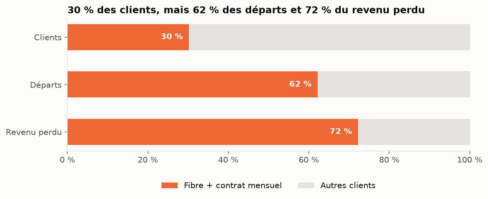
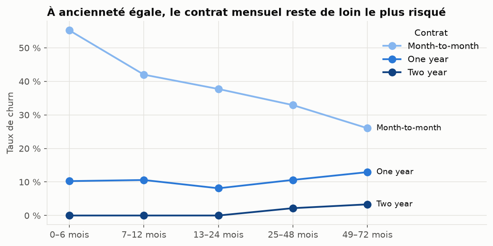

# Prédiction du churn client — Télécom

> Identifier les clients à risque de départ, comprendre pourquoi, et décider lesquels cibler pour **maximiser le gain net** d'une campagne de rétention.

**Statut :** en cours de développement

## Le problème

Sur 7 043 clients d'un opérateur télécom, **26,5 % sont partis**, ce qui représente **~1,67 M$ de revenu annuel perdu**. Les clients qui partent paient en moyenne **21 % de plus** que ceux qui restent (74,4 $ contre 61,3 $ par mois).

L'objectif n'est pas seulement de prédire le churn, mais de répondre à une question métier :
**quels clients faut-il contacter, et est-ce rentable ?**

Cadrage détaillé : [docs/cadrage_metier.md](docs/cadrage_metier.md)

## Démarche

| Phase | Contenu | Statut |
|---|---|---|
| 0 | Cadrage métier | ✅ |
| 1 | Mise en place du projet | ✅ |
| 2 | Qualité et nettoyage des données | ✅ |
| 3 | Analyse exploratoire orientée insights | ✅ |
| 4 | Feature engineering et pipeline | ⏳ |
| 5 | Modélisation et comparaison | ⏳ |
| 6 | Évaluation et optimisation business du seuil | ⏳ |
| 7 | Explicabilité (SHAP) | ⏳ |
| 8 | Application Streamlit | ⏳ |
| 9 | Valorisation et model card | ⏳ |

## Insights clés

Issus de l'analyse exploratoire ([notebook](notebooks/03_analyse_exploratoire.ipynb)), confirmés par des tests statistiques (χ² avec correction de Bonferroni, Mann-Whitney) et contrôlés pour les variables confondantes.

| # | Insight | Chiffre clé | Action de rétention |
|---|---|---|---|
| 1 | Le **contrat mensuel** est le 1er facteur de churn, même à ancienneté égale | 42,7 % contre 2,8 % en contrat 2 ans | Remise pour passer en contrat annuel |
| 2 | Les **6 premiers mois** sont critiques | 52,9 % de churn ; 55 % des départs la 1re année | Programme d'onboarding |
| 3 | **Fibre + contrat mensuel** = segment prioritaire | 30 % des clients → **72 % du revenu perdu** | Y concentrer le budget de rétention |
| 4 | Les **services de protection** fidélisent (effet dose) | De 56,7 % (aucun) à 5,3 % (quatre) | Offrir TechSupport / OnlineSecurity (à valider par test A/B) |
| 5 | Le **chèque électronique** signale un risque | 45,3 % contre ~15 % en paiement automatique | Inciter au prélèvement automatique |

Le **genre** n'a aucun lien avec le churn (p = 0,49).





## Avancement et résultats clés

**Phase 2 — Qualité des données** ([notebook](notebooks/02_qualite_donnees.ipynb))
- 11 valeurs manquantes **cachées** dans `TotalCharges` (un espace `" "`, invisible pour `isna()`), correspondant toutes à des clients de **0 mois d'ancienneté** → fixées à 0 (nouveaux clients pas encore facturés) plutôt qu'imputées.
- Aucun doublon réel, aucune valeur aberrante, cohérence `TotalCharges ≈ ancienneté × facture` vérifiée.
- Nettoyage industrialisé dans [`src/churn/data.py`](src/churn/data.py) et couvert par des tests, réutilisé tel quel par l'application.


## Données

[IBM Telco Customer Churn](https://www.kaggle.com/datasets/blastchar/telco-customer-churn) : 7 043 clients, 21 variables (profil, services souscrits, contrat, facturation, churn).

## Structure du projet

```
├── app/                 Application Streamlit
├── data/
│   ├── raw/             Données originales (jamais modifiées)
│   └── processed/       Données nettoyées (générées par le code)
├── docs/                Documentation (cadrage métier…)
├── models/              Modèles entraînés
├── notebooks/           Analyses numérotées par phase
├── reports/figures/     Graphiques exportés
├── src/churn/           Code réutilisable (config, nettoyage, features, modèle)
└── tests/               Tests unitaires (pytest)
```

## Installation

```bash
git clone https://github.com/cheikhahmedtidiane/projet_churn_clients.git
cd projet_churn_clients
python -m venv .venv
.venv\Scripts\activate          # Windows  (Linux/Mac : source .venv/bin/activate)
pip install -r requirements.txt
pytest                          # vérifie l'installation
```
